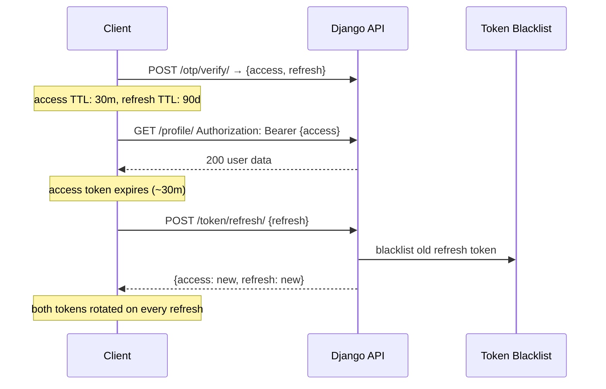

# JWT Configuration

Django-CFG wraps `djangorestframework-simplejwt` in a type-safe `JWTConfig`
Pydantic model. No manual `SIMPLE_JWT` dict needed — and it is **secure by
default**, so most projects write nothing at all.

## Quick Start

```python
from django_cfg import DjangoConfig, JWTConfig

class MyConfig(DjangoConfig):
    jwt = JWTConfig()  # long sessions: 1-year access and refresh · rotation + blacklist on
```

That bare `JWTConfig()` already gives the recommended posture. Override only if
you have a specific reason.

---

## Configuration Options

### Token Lifetimes

```python
jwt = JWTConfig(
    access_token_lifetime_minutes=30,    # MINUTES. Default None = max (1 year). Set 30 for short access tokens.
    refresh_token_lifetime_days=90,      # Default None = max (1 year).
    rotate_refresh_tokens=True,          # Rotate on every refresh (default)
    blacklist_after_rotation=True,       # Blacklist old refresh token (default)
)
```

> **Single access knob — minutes.** Access lifetime is expressed in
> `access_token_lifetime_minutes` (there is no `_hours` field). Keep it short:
> a leaked access token, sent on every request, then expires in minutes while
> the long refresh token keeps the user logged in.

### Security Settings

```python
jwt = JWTConfig(
    algorithm="HS256",           # HS256 | HS384 | HS512 | RS256 | RS384 | RS512 | ES256...
    update_last_login=True,      # Update user.last_login on token issue
    leeway=0,                    # Expiry leeway in seconds (0 = strict)
    audience="my-app",           # Optional JWT audience claim
    issuer="my-company",         # Optional JWT issuer claim
)
```

### Token Claims

```python
jwt = JWTConfig(
    user_id_field="id",              # User model field for ID
    user_id_claim="user_id",         # JWT claim name for user ID
    token_type_claim="token_type",   # JWT claim name for token type
    jti_claim="jti",                 # JWT claim name for token ID
    auth_header_types=("Bearer",),   # Accepted Authorization header types
)
```

### DPoP was removed

`JWTConfig` has no `dpop_enabled` field any more, and a leftover `dpop_enabled=...` fails
validation. Tokens issued earlier with a `cnf` claim keep working: the claim is ignored.
Why and what to change in a project: [Security → DPoP was removed](/configuration/security#dpop-was-removed).

---

## Secure-by-default philosophy

`JWTConfig` encodes the same layered model big SaaS platforms use — you inherit
it for free:

| Layer | What it does | Setting |
|-------|--------------|---------|
| Short access | small replay window for the most-exposed token | `access_token_lifetime_minutes=30` |
| Long refresh | "log in once, stay logged in" | `refresh_token_lifetime_days=90` |
| Rotation | every refresh issues a fresh refresh token | `rotate_refresh_tokens=True` |
| Blacklist | a reused (stolen) refresh token is revoked | `blacklist_after_rotation=True` |

Per-environment overrides are just plain config — e.g. tighten in production:

```python
class MyConfig(DjangoConfig):
    jwt: JWTConfig = JWTConfig()

    def model_post_init(self, __context):
        if not self.debug:  # production
            self.jwt = JWTConfig(access_token_lifetime_minutes=15)
```

---

## Token Lifecycle



`ROTATE_REFRESH_TOKENS = True` + `BLACKLIST_AFTER_ROTATION = True` by default.
Reusing a blacklisted token signals theft — rejected immediately.

### Logout — server-side revocation

`POST /cfg/accounts/token/blacklist/` with `{refresh}` blacklists the refresh
token immediately. The `@djangocfg/api` `logout()` calls it best-effort (local
logout never blocks on the network) — without it, "logout" would only clear
browser storage and a stolen refresh token would survive until its 365-day
expiry.

### Log everyone out

Access tokens are not covered by the refresh-token blacklist, and with long lifetimes they live long. Use:

```bash
python manage.py logout_all [--email user@example.com] [--dry-run]
```

It blacklists every live refresh token, sets `CustomUser.tokens_valid_after` to now and clears Django sessions.
`JWTAuthenticationWithLastLogin` rejects any access token issued at or before that cutoff with code `token_revoked`,
whatever its `exp`. API keys are untouched. With `--email` only that user is affected (sessions are cleared only for
the whole-site run).


---

## Supported Algorithms

| Type | Algorithms |
|------|-----------|
| HMAC (symmetric) | `HS256`, `HS384`, `HS512` |
| RSA (asymmetric) | `RS256`, `RS384`, `RS512` |
| ECDSA (asymmetric) | `ES256`, `ES384`, `ES512` |

Keeping `HS256` for tokens is fine. For multi-service verification without
sharing a secret, `RS256` is convenient:

```python
jwt = JWTConfig(algorithm="RS256")
```

---

## Migration from manual SIMPLE_JWT

Before:
```python
# settings.py
SIMPLE_JWT = {
    'ACCESS_TOKEN_LIFETIME': timedelta(minutes=30),
    'REFRESH_TOKEN_LIFETIME': timedelta(days=90),
    'ROTATE_REFRESH_TOKENS': True,
    'BLACKLIST_AFTER_ROTATION': True,
    # ... 15+ more settings
}
```

After:
```python
# config.py
jwt = JWTConfig()   # secure defaults; everything configured automatically
```

---

## Introspection

```python
# Effective access-token lifetime (timedelta)
config.jwt.get_effective_access_token_lifetime()
# → datetime.timedelta(days=365)       # default; JWTConfig.short_lived() gives 30 min

# Raw Django settings
settings = config.jwt.to_django_settings(config.secret_key)
settings['SIMPLE_JWT']['ACCESS_TOKEN_LIFETIME']   # → timedelta(minutes=30)
```

TAGS: jwt, JWTConfig, token rotation, simplejwt, token lifetime
DEPENDS_ON: [index, otp]
