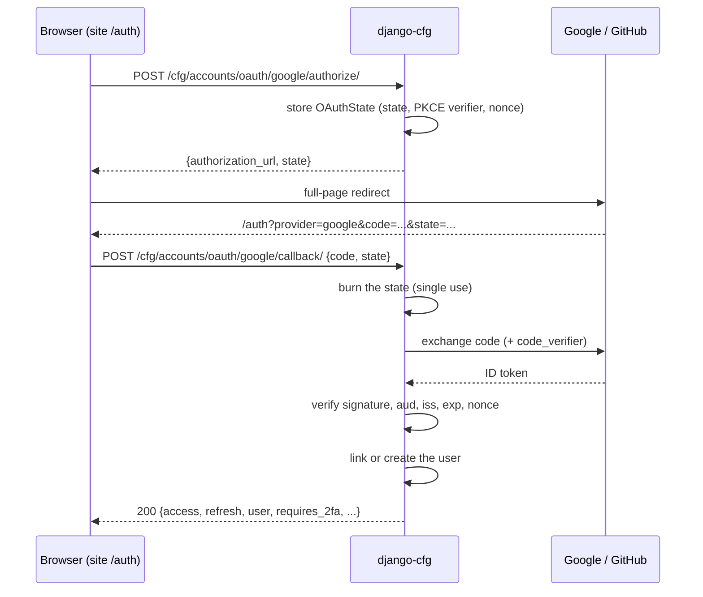

import { Callout } from 'nextra/components'

# OAuth (Google and GitHub sign-in)

"Continue with Google" and "Continue with GitHub" through the same endpoints, token issue, 2FA hand-off and return-URL flow as the email code. The callback answers with the same JWT body as `otp/verify/`, so `useAuth` handles every method alike.

You supply a client id and a secret. Everything else — scopes, PKCE, nonce, state lifetime, redirect URIs, account linking — is decided by django-cfg.

## Turn a provider on

Set both variables in the process environment (container `env_file`, `.env`):

```bash
GOOGLE_OAUTH__CLIENT_ID=1234-abc.apps.googleusercontent.com
GOOGLE_OAUTH__CLIENT_SECRET=GOCSPX-...
GITHUB_OAUTH__CLIENT_ID=Iv1.abc123
GITHUB_OAUTH__CLIENT_SECRET=...
```

Both set means the provider is on, either one missing means off (and `manage.py check` warns about a half-filled pair). Leave `DjangoConfig.google_oauth` / `github_oauth` unset and nothing else is needed.

If your settings loader reads a dotenv file only into its own object (not `os.environ`), pass the values explicitly:

```python
from django_cfg import DjangoConfig, GoogleOAuthConfig, GitHubOAuthConfig

class MyConfig(DjangoConfig):
    google_oauth = GoogleOAuthConfig(client_id=env.google_client_id, client_secret=env.google_client_secret)
    github_oauth = GitHubOAuthConfig(client_id=env.github_client_id, client_secret=env.github_client_secret)
```

An explicit object wins over the environment. Remove it to turn the provider off. The only extra knob is `GoogleOAuthConfig.allowed_hosted_domains` (see [Google Workspace only](#google-workspace-only)). Full reference: [OAuth configuration](/features/integrations/oauth/configuration).

Apply the migration once: `python manage.py migrate django_cfg_accounts`.

Creating the Google client by hand is the one step django-cfg cannot do: follow [Google Cloud setup](/features/integrations/oauth/google), and run `python manage.py oauth_check` to print the exact redirect URIs to paste.

## The flow



- The **redirect URI** is `<site origin>/auth?provider=<id>`. The origin comes from the request `Origin` header when the resolved [`Site`](/configuration/sites) accepts it (a declared origin or a subdomain of its registrable domain; register those URIs at the provider too), otherwise (no header) from `site_url`. An origin no site accepts is refused with `origin_not_allowed`, never replaced. The callback ignores any client-sent `redirect_uri` and reuses the one stored with the state.
- **State** is a database row (`OAuthState`), valid 600 s for Google and 300 s for GitHub. The callback deletes it before doing anything else; of two parallel callbacks exactly one wins. Any failure after that point (bad code, wrong provider, expired) has already spent the state, so a retry starts a new flow.
- **Google** uses PKCE (S256) and an OIDC `nonce`. The ID token is verified against Google's signing keys (RS256 only, key looked up by `kid`, audience, issuer, expiry, `azp`, nonce). Anything unverifiable closes: a JWKS outage is `provider_unavailable`, not a fallback. Scopes are `openid email profile`; no refresh token is requested and Google's access token is not stored.
- **GitHub** uses the classic code flow (GitHub has neither PKCE nor nonce here). A profile email only counts when `/user/emails` lists it as verified.
- Expired states are purged on every new flow and by a scheduled job every 10 minutes.

## One verified email is one user

Whichever way someone signs in — email code, GitHub, Google, in any order — they land on the same account. Providers are identities attached to the user (`OAuthConnection`); a second provider with the same verified email links to the existing user and never creates a duplicate.

Email is mandatory. A provider answer without an email, or with an email the provider does not vouch for, is no sign-in and no registration (`email_missing`, `email_not_verified`). The one exception is GitHub's historical `login@github.local` placeholder for accounts that hide every email; such a user is created unverified and is never marked verified.

### The linking rule

After a verified email is in hand:

1. A connection for this provider account (`provider` + Google `sub` / GitHub numeric id) exists: that user signs in. The provider's email changing later does not matter.
2. Otherwise the user who owns the mailbox is found by the **canonical email** (`email_key`, see below), not soft-deleted:
   - inactive: `account_inactive`;
   - staff or superuser: `link_not_allowed` (never linked by email; they sign in the way they do today);
   - otherwise the connection is added to that user, whatever `is_email_verified` said. If that account had never been verified, its password is made unusable in the same transaction, so a password set before the email was proven cannot survive the proof.
3. Nobody owns the mailbox: a new user is created with a verified email.

A user who deleted their account (soft delete) loses the stale connection and can register again.

### `email_key`

`CustomUser.email_key` is the canonical form of the address: lower case, and for `gmail.com` / `googlemail.com` the dots and any `+tag` removed with the domain folded to `gmail.com` (Google treats these as one mailbox). Other domains are only lower-cased. The address as typed stays in `email`. The email code login and the OAuth callback both look users up by this key, so `j.doe@gmail.com`, `jdoe+x@googlemail.com` and `JDoe@gmail.com` are one user.

Accounts created before the key existed are backfilled by the migration. If two old accounts already share a key, sign-in picks the oldest and never merges; list them with:

```bash
python manage.py email_key_report
```

## Google Workspace only

```python
google_oauth = GoogleOAuthConfig(
    client_id=..., client_secret=...,
    allowed_hosted_domains=["corp.example"],
)
```

With a non-empty list the signed `hd` claim of the ID token must be in it. A plain Gmail account has no `hd` and is refused with `hosted_domain_not_allowed`. A single entry is also sent as the `hd` hint so Google preselects the domain.

## API

All under `/cfg/accounts/oauth/`, tag `cfg_accounts_oauth`.

| Method | Path | Rate limit | Auth | Purpose |
|--------|------|------------|------|---------|
| GET | `providers/` | — | public | `{providers: [{id, name, icon}]}` of the configured providers, in display order (`github`, `google`) |
| POST | `github/authorize/` · `google/authorize/` | 20/min/IP | public | body `{source_url?, redirect_uri?}` → `{authorization_url, state}` |
| POST | `github/callback/` · `google/callback/` | 10/min/IP | public | body `{code, state}` → the `otp/verify/` token body |
| GET | `connections/` | — | required | the user's connections |
| POST | `disconnect/` | — | required | `{provider}`; the user can still sign in by email code |

The callback body: `requires_2fa`, `session_id` (when 2FA), `access`, `refresh`, `user`, `is_new_user`, `is_new_connection`, `should_prompt_2fa`. A user with a TOTP device gets `requires_2fa: true` and no tokens, for either provider.

On a successful sign-in with a real verified address the [`user_email_verified`](/features/built-in-apps/user-management/accounts#extension-signals) signal fires with `consent=None`, exactly as for the email code, so one receiver covers every method.

### Error codes

Every failure is `{ "error": "<code>", "error_description": "<text>" }`. The codes are a closed set (the `error` field is an enum in the OpenAPI schema).

| Code | HTTP | Meaning |
|------|------|---------|
| `oauth_disabled` | 503 | the provider is not configured |
| `github_oauth_disabled` | 503 | same, GitHub's historical code |
| `origin_not_allowed` | 400 | the request `Origin` (or `redirect_uri`) is not an origin of the resolved site |
| `missing_redirect_uri` | 400 | no site could be resolved or it has no `site_url` |
| `invalid_state` | 400 | unknown, expired, already used, or issued for another provider |
| `oauth_exchange_failed` | 400 | the provider rejected the code or the profile request |
| `invalid_id_token` | 400 | Google's ID token failed validation (signature, aud, iss, exp, nonce, sub) |
| `email_missing` | 400 | no email in the provider answer |
| `email_not_verified` | 400 | the provider does not vouch for the email |
| `hosted_domain_not_allowed` | 403 | `hd` not in `allowed_hosted_domains` |
| `account_inactive` | 403 | the matching user is disabled |
| `link_not_allowed` | 403 | the mailbox belongs to staff or a superuser |
| `rate_limited` | 429 | too many requests from this IP |
| `provider_unavailable` | 502 | the provider or its key endpoint did not answer |
| `server_error` | 500 | anything unexpected |
| `not_found` | 404 | `disconnect/`: no such connection |

A provider that sends the browser back with `?error=access_denied` (the user pressed Cancel) has no `code`; the site's `/auth` page handles that, the API is not called.

## Check it

```bash
python manage.py oauth_check            # config, redirect URIs per site, console links, findings
python manage.py oauth_check --probe    # also asks each provider whether the client id and secret are accepted
```

`--probe` posts a dummy code to the token endpoint: `invalid_grant` means the client id and secret are accepted, `invalid_client` means one is wrong. Nothing is spent or changed. The command exits 1 on any finding or failed probe. Details and the matching system checks: [OAuth configuration](/features/integrations/oauth/configuration#diagnostics).

## Data

| Model | Notes |
|-------|-------|
| `OAuthConnection` | `user`, `provider` (`github` / `google`), `provider_user_id` (up to 255, Google `sub`), email/username/name/avatar of the provider, `raw_data`, `access_token` (GitHub only; empty for Google), `last_login_at`; unique per (`provider`, `provider_user_id`) |
| `OAuthState` | `state` (primary key), `provider`, `redirect_uri`, `source_url`, `code_verifier`, `nonce`, `expires_at`; hidden fields are not shown in the admin |
| `CustomUser.email_key` | canonical email, indexed |

`source_url` in the authorize body is normalised to the `site_url` of the matching [site](/configuration/sites) (`resolve_source_url`), and the user's `RegistrationSource` is created from it. The same rule applies to OTP sign-in.

<Callout type="info">
State lives in the database, not the cache, so it survives restarts and works across processes. The OAuth views run outside the request transaction on purpose: spending the state must commit immediately, and no transaction should stay open while the provider is called.
</Callout>

## Frontend

The login screen asks `GET oauth/providers/` and shows exactly the enabled buttons. See [Accounts frontend](/features/built-in-apps/user-management/accounts/frontend) and [OAuth frontend](/features/integrations/oauth/frontend).

TAGS: oauth, google, github, social login, GoogleOAuthConfig, GitHubOAuthConfig, account linking, email_key, oauth_check
DEPENDS_ON: [index, otp, jwt]
