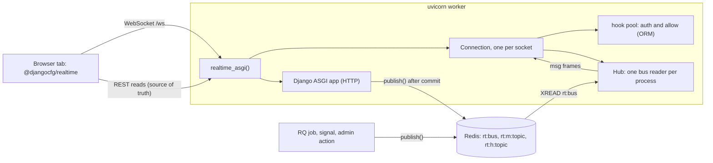

# Realtime — WebSocket topics

`django_cfg.modules.django_realtime` pushes events to the browser over one WebSocket per tab. You declare topics next to your models, call `publish()` from ordinary sync code (views, signals, admin actions, RQ jobs), and the generated client gets a typed builder per topic. The socket is served by the same uvicorn process as Django: no second server, no Channels, no token system of its own.

The browser half is `@djangocfg/realtime`. `BaseApp` from `@djangocfg/layouts` mounts it, so a component only calls `useTopic`.

## What you get

- **Django identity.** The handshake runs your project's DRF authenticators (JWT, session, API key). A bearer token goes in the first frame, never in the URL.
- **Origin allow-list.** A cookie-authenticated socket opened from a foreign page is refused (close 4403).
- **Typed topics.** A topic has a pattern, a pydantic event model and an `allow(user, **params)` function. `publish()` validates the event and raises on an unknown topic or a bad payload; it never drops silently.
- **After commit.** Inside a transaction the publish waits for the commit; a rollback sends nothing.
- **Model hints.** `broadcasts(Order, topic)` sends one hint per topic per committed transaction, with no code in your views.
- **Replay that tells the truth.** A reconnect with `since` gets the missed messages, or `recovered: false` when the history no longer reaches back (or Redis lost data). The client then refetches over REST.
- **Hints first.** The default event is an empty hint. The REST API stays the source of truth.
- **Self-refreshing cache keys.** `@invalidated_by("orders:{order_id}")` on a DRF view tags the generated SWR key with the topic; the page revalidates on each publication with no realtime code.
- **No ORM on the event loop.** Auth and `allow` run in a small bounded thread pool, with stale connections closed around every call.
- **Revocation.** Logout, `logout_all`, a password change and deactivation close the user's sockets (close 4419); the credential is also re-checked every 15 minutes.
- **No echo.** A request that sends `X-Realtime-Cid` does not get its own change back.
- **Tests without a server.** `realtime_outbox` captures publishes like `mail.outbox`; `WebSocketDriver` drives the ASGI app directly.

## Why not Channels or Centrifugo

Django core has no WebSocket: its ASGI handler refuses every non-`http` scope. The two usual answers both cost more than they give here.

- **Channels.** Its consumer and group abstractions duplicate what one Redis stream gives, and still give no replay. Its tests are structural trouble: `WebsocketCommunicator` needs top-level async tests, and ORM calls made through `sync_to_async` run outside the test's transaction (Django ticket #32409). This module keeps the ORM out of the async handler entirely, so a `TestCase` works.
- **Centrifugo.** django-cfg shipped a Centrifugo integration before and removed it in 2.3.0. Every earlier attempt failed on a second system with its own identity: a separate process, its own config format, tokens that broke silently, a token claim that was not authorization. Identity, permission and configuration here stay inside Django.

Every django-cfg project already runs `uvicorn api.asgi:application` in production, so a WebSocket route needs no new server type.

## Architecture

- `realtime_asgi()` sends websocket scopes on `RealtimeConfig.path` (`/ws`) to the realtime handler and everything else to Django. It also answers lifespan, so a shutdown closes every socket with 1012.
- `publish()` appends to Redis with one Lua script: the topic's offset (`rt:m:<topic>`), its replay history (`rt:h:<topic>`) and the delivery bus (`rt:bus`).
- Each process reads `rt:bus` once and fans out locally. Subscribing and unsubscribing never touch Redis.
- Without Redis (development, tests) an in-process memory backend with the same rules is used.

## Pages

<Cards>
  <Cards.Card title="Quick Start" href="/features/modules/django-realtime/quick-start">asgi.py, config, a first topic, publish, useTopic</Cards.Card>
  <Cards.Card title="Topics & Permissions" href="/features/modules/django-realtime/topics-and-permissions">Patterns, event models, allow, anonymous topics, history, limits</Cards.Card>
  <Cards.Card title="Publishing" href="/features/modules/django-realtime/publishing">publish, on_commit, broadcasts, touch, suppress, X-Realtime-Cid</Cards.Card>
  <Cards.Card title="Frontend" href="/features/modules/django-realtime/frontend">BaseApp, useTopic, typed topics, zero-code SWR refresh, RealtimePanel</Cards.Card>
  <Cards.Card title="Code Generation" href="/features/modules/django-realtime/codegen">realtime.ts, tagged SWR keys, the ':' or '.' rule</Cards.Card>
  <Cards.Card title="Testing" href="/features/modules/django-realtime/testing">realtime_outbox, WebSocketDriver with inline hooks, the mock server</Cards.Card>
  <Cards.Card title="Deployment" href="/features/modules/django-realtime/deployment">uvicorn flags, Docker, Traefik, Cloudflare, Redis, system checks</Cards.Card>
  <Cards.Card title="Wire Protocol v1" href="/features/modules/django-realtime/protocol">Frames, close codes, offsets</Cards.Card>
</Cards>
