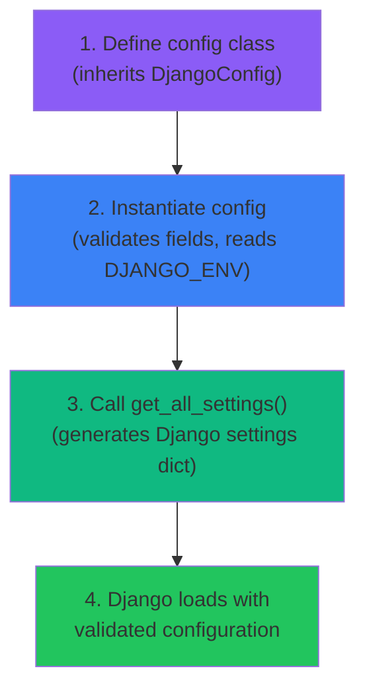
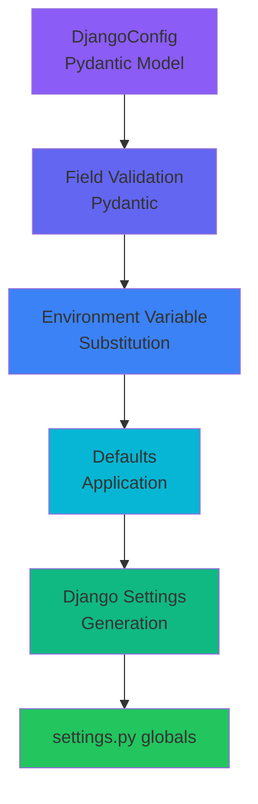

# Django-CFG - Type-Safe Django Configuration

## What is Django-CFG?

Django-CFG is a configuration framework for Django that replaces traditional settings.py with type-safe Pydantic v2 models. It validates configuration at startup, provides IDE autocomplete, and integrates with enterprise services.

**Core principle:** Configuration errors should fail at startup, not in production.

---

## What You Get

- **Startup validation:** configuration errors fail before Django loads, not in production
- **Self-documenting config:** type hints and field descriptions show up in the IDE
- **Sensible built-ins:** accounts (OTP sign-in), the Django admin with the django-cfg theme and navigation, health endpoints and the client generator are installed by default; Redis cache, RQ, payments, MCP and others are config sections you switch on
- **Environment-aware:** development, production and test modes via `env_mode`
- **Built-in practices:** security domains drive `ALLOWED_HOSTS`, CORS and CSRF; smart logging with request ids

---

## Real-World Code Comparison

### Traditional Django Settings (200+ lines)

```python
# settings.py - Traditional approach
import os
from pathlib import Path

BASE_DIR = Path(__file__).resolve().parent.parent

# Security settings - manual string parsing
SECRET_KEY = os.environ.get('SECRET_KEY', 'fallback-insecure-key')
DEBUG = os.environ.get('DEBUG', 'False').lower() in ('true', '1', 'yes')

# Hosts - manual list parsing
ALLOWED_HOSTS = os.environ.get('ALLOWED_HOSTS', 'localhost,127.0.0.1').split(',')

# CORS - manual configuration
CORS_ALLOWED_ORIGINS = [
    f"https://{host}" for host in ALLOWED_HOSTS if host not in ['localhost', '127.0.0.1']
]
CORS_ALLOW_CREDENTIALS = True
CSRF_TRUSTED_ORIGINS = CORS_ALLOWED_ORIGINS

# Database - manual type conversion
DATABASES = {
    'default': {
        'ENGINE': 'django.db.backends.postgresql',
        'NAME': os.environ.get('DB_NAME', 'mydb'),
        'USER': os.environ.get('DB_USER', 'postgres'),
        'PASSWORD': os.environ.get('DB_PASSWORD', ''),
        'HOST': os.environ.get('DB_HOST', 'localhost'),
        'PORT': int(os.environ.get('DB_PORT', '5432')),  # Manual int conversion
        'OPTIONS': {
            'connect_timeout': 10,
        }
    }
}

# Cache - manual configuration
CACHES = {
    'default': {
        'BACKEND': 'django.core.cache.backends.redis.RedisCache',
        'LOCATION': f"redis://{os.environ.get('REDIS_HOST', 'localhost')}:{os.environ.get('REDIS_PORT', '6379')}/0",
        'OPTIONS': {
            'CLIENT_CLASS': 'django_redis.client.DefaultClient',
        }
    }
}

# Email - manual backend selection
EMAIL_BACKEND = os.environ.get('EMAIL_BACKEND', 'django.core.mail.backends.console.EmailBackend')
if EMAIL_BACKEND == 'smtp':
    EMAIL_BACKEND = 'django.core.mail.backends.smtp.EmailBackend'
    EMAIL_HOST = os.environ.get('EMAIL_HOST', 'localhost')
    EMAIL_PORT = int(os.environ.get('EMAIL_PORT', '587'))
    EMAIL_USE_TLS = os.environ.get('EMAIL_USE_TLS', 'True').lower() in ('true', '1')
    EMAIL_HOST_USER = os.environ.get('EMAIL_HOST_USER', '')
    EMAIL_HOST_PASSWORD = os.environ.get('EMAIL_HOST_PASSWORD', '')

# Installed apps - manual list management
INSTALLED_APPS = [
    'django.contrib.admin',
    'django.contrib.auth',
    'django.contrib.contenttypes',
    'django.contrib.sessions',
    'django.contrib.messages',
    'django.contrib.staticfiles',
    'corsheaders',
    'rest_framework',
    # ... your apps
]

# Middleware - manual ordering
MIDDLEWARE = [
    'django.middleware.security.SecurityMiddleware',
    'corsheaders.middleware.CorsMiddleware',
    'django.contrib.sessions.middleware.SessionMiddleware',
    'django.middleware.common.CommonMiddleware',
    'django.middleware.csrf.CsrfViewMiddleware',
    'django.contrib.auth.middleware.AuthenticationMiddleware',
    'django.contrib.messages.middleware.MessageMiddleware',
    'django.middleware.clickjacking.XFrameOptionsMiddleware',
]

# ... 100+ more lines for static files, templates, logging, etc.
```

**Issues:**

- 200+ lines of configuration code
- Manual type conversion everywhere
- String parsing errors go unnoticed
- No validation until runtime
- No IDE autocomplete
- Hard to test different configurations
- Environment variables scattered everywhere

### Django-CFG Approach (30 lines)

```python
# config.py
from django_cfg import DjangoConfig, DatabaseConfig, CacheConfig, EmailConfig
from typing import Dict
from .environment import env  # your own typed environment loader

class MyConfig(DjangoConfig):
    """Complete production configuration with type safety"""

    # Security - validated at startup
    project_name: str = "My Project"
    secret_key: str = env.secret_key  # from your environment loader
    debug: bool = False

    # Single field auto-generates: ALLOWED_HOSTS, CORS_*, CSRF_TRUSTED_ORIGINS, SSL settings
    security_domains: list[str] = ["myapp.com"]

    # Database - type-safe, validated
    databases: Dict[str, DatabaseConfig] = {
        "default": DatabaseConfig(
            engine="django.db.backends.postgresql",
            name=env.database.name,
            user=env.database.user,
            password=env.database.password,
            host=env.database.host,
            port=env.database.port,  # Already int from Pydantic
        )
    }

    # Cache - auto-created from redis_url!
    redis_url: str = f"redis://{env.redis.host}:{env.redis.port}/0"
    # No cache_default needed - Django-CFG creates it automatically!

    # Email - type-safe with validation
    email: EmailConfig = EmailConfig(
        backend="smtp",
        host=env.email.host,
        port=env.email.port,
        use_tls=True,
        username=env.email.username,
        password=env.email.password,
    )

# settings.py - just 2 lines
config = MyConfig()
globals().update(config.get_all_settings())
```

**Benefits:**

- **Far less code** than the hand-written equivalent
- **Type-safe** - Pydantic validates at startup
- **IDE autocomplete** - all fields discovered
- **Single security field** - generates `ALLOWED_HOSTS`, CORS, CSRF and SSL settings
- **Validated env** - typed environment loader with Pydantic models
- **No runtime errors** - fails before Django loads
- **Easy testing** - just instantiate config class

---

## Real-World Use Cases

### 1. E-Commerce Platform (Multi-Database Setup)

**Challenge:** Product catalog in PostgreSQL, session cache in Redis, order analytics in separate read replica.

**Traditional Django:** a hand-written database router, cache configuration and manual connection management.

**With Django-CFG:**
```python
class ECommerceConfig(DjangoConfig):
    security_domains: list[str] = ["shop.example.com"]

    databases: Dict[str, DatabaseConfig] = {
        "default": DatabaseConfig(
            engine="django.db.backends.postgresql",
            name=env.db.products.name,
            host=env.db.products.host,
        ),
        "analytics": DatabaseConfig(  # Read replica
            engine="django.db.backends.postgresql",
            name=env.db.analytics.name,
            host=env.db.analytics.host,
        ),
    }

    # Auto Redis cache - just set redis_url!
    redis_url: str = f"redis://{env.redis.host}:6379/0"

```

**Result:** one typed block replaces the hand-written router; routing is declared with `apps=[...]` on each database.

### 2. SaaS Application (Environment-Specific Configuration)

**Challenge:** Different settings for dev/staging/prod. SSL in production only. Debug emails in development.

**Traditional Django:** Multiple settings files (settings_dev.py, settings_prod.py), inheritance issues, settings conflicts.

**With Django-CFG:**
```python
class SaaSConfig(DjangoConfig):
    project_name: str = "MySaaS Platform"
    secret_key: str = env.secret_key

    debug: bool = False

    # SSL redirect follows the environment (on in production, off in development)
    security_domains: list[str] = ["app.mysaas.com"]

    # Pick the email backend per environment
    email: EmailConfig = EmailConfig(
        backend="console" if env.environment == "development" else "smtp",
        host=env.email.host if env.environment != "development" else "localhost",
    )

    # JWT for API authentication (tokens are signed with secret_key)
    jwt: JWTConfig = JWTConfig(
        access_token_lifetime_minutes=60,
        refresh_token_lifetime_days=30,
    )

```

**Result:** one config file for all environments, with environment detection through `env_mode`.

### 3. Enterprise API Service (Complex Integrations)

**Challenge:** Redis cache, PostgreSQL, SMTP email and generated API docs in one service.

**Traditional Django:** several third-party packages, long configuration and manual credential management.

**With Django-CFG:**
```python
from django_cfg import DjangoConfig, DatabaseConfig, EmailConfig, SpectacularConfig
from typing import Dict

class APIServiceConfig(DjangoConfig):
    security_domains: list[str] = ["api.enterprise.com"]

    # Database
    databases: Dict[str, DatabaseConfig] = {
        "default": DatabaseConfig(
            engine="django.db.backends.postgresql",
            name=env.database.name,
            host=env.database.host,
            conn_max_age=600,  # Connection pooling
        )
    }

    # Email configuration
    email: EmailConfig = EmailConfig(
        host=env.email.host,
        port=env.email.port,
        use_tls=True,
    )

    # The default cache is created from redis_url; for task queues add a DjangoRQConfig
    redis_url: str = f"redis://{env.redis.host}:6379/0"

    # API documentation auto-generated
    spectacular: SpectacularConfig = SpectacularConfig(
        title="Enterprise API",
        description="Production API with authentication",
        version="2.0.0",
    )
```

**Result:** integrations are type-safe and validated at startup, with generated API docs.

### 4. Startup MVP (Rapid Development)

**Challenge:** Ship fast: user auth and email notifications.

**Traditional Django:** install and configure each package, wire everything together, write a custom user model.

**With Django-CFG:**
```python
class MVPConfig(DjangoConfig):
    project_name: str = "Startup MVP"
    secret_key: str = env.secret_key
    security_domains: list[str] = ["mvp.startup.io"]

    # Production-ready database
    databases: Dict[str, DatabaseConfig] = {
        "default": DatabaseConfig(
            engine="django.db.backends.postgresql",
            name=env.database.name,
            host=env.database.host,
        )
    }


    # Email notifications
    email: EmailConfig = EmailConfig(
        backend="smtp",
        host="smtp.gmail.com",
        port=587,
        use_tls=True,
        username=env.email.username,
        password=env.email.app_password,
    )
```

**Create and run:**
```bash
django-cfg create-project startup_mvp
cd startup_mvp
python manage.py migrate
python manage.py runserver
```

**Result:** accounts, admin, email and the generator are available from a short config.

---

## Key Concepts

### Type Safety with Pydantic v2

Django-CFG uses Pydantic BaseModel for all configuration. This means:

- **Validation at startup:** Invalid configuration fails before Django loads
- **Type checking:** mypy/pyright can verify your configuration
- **IDE support:** Full autocomplete for all configuration fields
- **Documentation:** Field descriptions become IDE hints

### Configuration Lifecycle



### Environment Configuration Pattern

Your project loads environment values with a type-safe loader (pydantic-settings here), and Django-CFG validates what you pass in:

```python
# environment.py
from pydantic_settings import BaseSettings, SettingsConfigDict

class DatabaseEnv(BaseSettings):
    name: str
    user: str
    password: str
    host: str
    port: int = 5432

class EnvironmentConfig(BaseSettings):
    model_config = SettingsConfigDict(env_file=".env", env_nested_delimiter="__")

    secret_key: str
    database: DatabaseEnv

# Reads SECRET_KEY and DATABASE__NAME, DATABASE__USER, ... from the environment or .env
env = EnvironmentConfig()
```

## Basic Example

```python
from django_cfg import DjangoConfig, DatabaseConfig, CacheConfig
from typing import Dict
from .environment import env

class MyConfig(DjangoConfig):
    """Project configuration with type validation"""

    # Type-safe environment loading
    secret_key: str = env.secret_key

    # Boolean field with default
    debug: bool = False

    # Security domains - replaces ALLOWED_HOSTS
    # Will auto-generate ALLOWED_HOSTS, CORS settings, SSL config
    security_domains: list[str] = ["myapp.com"]

    # Database with type-safe environment values
    databases: Dict[str, DatabaseConfig] = {
        "default": DatabaseConfig(
            engine="django.db.backends.postgresql",
            name=env.database.name,
            user=env.database.user,
            password=env.database.password,
            host=env.database.host,
            port=env.database.port,
        )
    }

    # Cache - auto-created from redis_url (recommended)
    redis_url: str | None = "redis://localhost:6379/0"
    # Django-CFG automatically creates CacheConfig!

    # Advanced: Manual cache override (optional)
    # cache_default: CacheConfig | None = None  # Only if custom backend needed

# In settings.py
config = MyConfig()
globals().update(config.get_all_settings())
```

<Callout type="info">
**Extensions**

Your `DjangoConfig` can stay small: extensions found in the project's extensions folder configure themselves instead of being listed in one file.

```python
# Modern approach - extensions auto-discovered!
class MyConfig(DjangoConfig):
    project_name: str = "My SaaS"
    databases: Dict[str, DatabaseConfig] = {...}
    project_apps: list[str] = ["core"]  # Only your apps
    # Extensions found in the extensions folder register themselves
```

[Learn about Extensions](../../extensions) | [Migration Guide](../../extensions/migration-guide)
</Callout>

## Why Use Django-CFG?

### Problem: Traditional Django Settings

Traditional Django settings.py has several issues for production systems:

1. **No type validation:** `DEBUG = os.environ.get('DEBUG', 'False') == 'True'` - easy to get wrong
2. **No field validation:** Missing required variables only fail at runtime
3. **No IDE support:** No autocomplete, no type hints
4. **Hard to test:** Settings are global, difficult to test different configurations
5. **Environment management:** Manually check environment and set values

### Solution: Type-Safe Configuration Models

Django-CFG solves these with Pydantic models:

```python
# Traditional settings.py - prone to errors
DEBUG = os.environ.get('DEBUG', 'False') == 'True'  # String comparison!
DATABASES = {
    'default': {
        'ENGINE': 'django.db.backends.postgresql',
        'PORT': os.environ.get('DB_PORT', '5432'),  # Still a string!
    }
}

# Django-CFG - type-safe and validated
class MyConfig(DjangoConfig):
    debug: bool = False  # Pydantic validates boolean conversion
    databases: Dict[str, DatabaseConfig] = {
        "default": DatabaseConfig(
            engine="django.db.backends.postgresql",
            port=5432,  # Integer type enforced
        )
    }
```

### Comparison with Alternatives

| Feature | Django-CFG | django-environ | python-decouple |
|---------|------------|----------------|------------------|
| Type Safety | Pydantic v2 models | Runtime casting | Runtime casting |
| Validation | Field validators | Manual | Manual |
| IDE Support | Full autocomplete | None | None |
| Error Messages | Detailed with context | Generic | Generic |
| Nested Config | Yes (models) | No | No |
| Testing | Easy (instantiate config) | Difficult (global) | Difficult (global) |

## When to Use Django-CFG

### Recommended For

- Production applications where configuration errors are critical
- Teams using type hints and mypy/pyright
- Projects with complex configuration (multiple databases, caching strategies)
- Applications requiring validated configuration at startup
- Projects needing multi-environment support (dev/staging/prod)

### Consider Alternatives If

- Simple Django project with &lt;10 configuration values
- Team doesn't use type hints
- Legacy codebase without resources for refactoring
- No automated testing or CI/CD

**Migration note:** Moving from settings.py to Django-CFG requires refactoring. Plan for testing time.

## Quick Start

### 1. Install

```bash
# Create virtual environment (Python 3.12+ required)
python3.12 -m venv .venv && source .venv/bin/activate

# Install Django-CFG
pip3 install 'django-cfg[full]'
```

### 2. Create Config Class

```python
# config.py
from django_cfg import DjangoConfig, DatabaseConfig
from typing import Dict
from .environment import env

class MyConfig(DjangoConfig):
    project_name: str = "My Project"
    secret_key: str = env.secret_key  # from your environment loader
    debug: bool = False

    # security_domains replaces ALLOWED_HOSTS
    security_domains: list[str] = ["localhost"]

    databases: Dict[str, DatabaseConfig] = {
        "default": DatabaseConfig(
            engine="django.db.backends.postgresql",
            name=env.database.name,
            user=env.database.user,
            password=env.database.password,
            host=env.database.host,
            port=5432,
        )
    }
```

### 3. Use in Settings

```python
# settings.py
from config import MyConfig

config = MyConfig()
globals().update(config.get_all_settings())
```

### 4. Set Environment Variables

The names depend on your environment loader; for the loader in [First Project](./first-project):

```bash
export SECRET_KEY="your-secret-key-here-min-50-chars-long-or-validation-fails"
export DATABASE__NAME="myapp"
export DATABASE__USER="postgres"
export DATABASE__PASSWORD="password"
```

### 5. Verify Configuration

```bash
python manage.py check
```

If configuration is invalid, Django-CFG will show detailed error messages before Django loads.

## Built-in Features

Django-CFG includes optional integrations that can be enabled via configuration flags:

### Core Configuration
- **Environment detection:** Automatically detects development/production/test based on environment variables
- **Security domains:** Single field that auto-configures ALLOWED_HOSTS, CORS, SSL redirects
- **Database routing:** Declarative routing with `DatabaseConfig(apps=[...])`
- **Startup validation:** All configuration validated before Django starts

### Optional Built-in Apps

Accounts (OTP sign-in, 2FA) is always installed. Optional features are config sections (`currency`, `geo`, `payments`, `django_rq`, `mcp`, `notion`, ...) and a few flags:

```python
class MyConfig(DjangoConfig):
    enable_pool_cleanup: bool = False # Database connection pool cleanup
    enable_drf_tailwind: bool = False # Tailwind CSS for DRF views
```

### Integrations

- **Admin site:** the stock Django admin with django-cfg navigation, branding and a dark-by-default theme (`admin_site=AdminSiteConfig(...)`)
- **Django-CFG API Client Generation:** API zones with automatic OpenAPI documentation
- **Django-RQ:** Background task processing (`django_rq=DjangoRQConfig(...)`)
- **Telegram:** Bot integration for notifications
- **Email:** SMTP or console backend

See [Features documentation](../../features/built-in-apps/overview) for details on each integration.

## Architecture Overview



**Key concepts:**

1. **Single source of truth:** Config class defines all settings
2. **Fail-fast validation:** Errors at instantiation, not during requests
3. **Validated on assignment:** changing a field after instantiation re-runs validation
4. **Type-safe everywhere:** Full IDE support from config to Django settings

## Next Steps

### New to Django-CFG?

1. [Installation Guide](./installation) - Install and verify setup
2. [First Project](./first-project) - Create a project from scratch
3. [Configuration Reference](./configuration) - All configuration options

### Migrating Existing Project?

1. [Migration Guide](../../guides/migration-guide) - Step-by-step migration from settings.py
2. [Production Configuration](../../guides/production-config) - Production best practices
3. [Multi-Database Setup](../../guides/multi-database) - Complex database routing

### Need Specific Features?

- [Database Configuration](../../configuration) - Multiple databases, routing
- [Caching Setup](../../configuration) - Redis, in-memory, database caching
- [Background Tasks](/features/modules/django-rq) - Async task processing

## Resources

**Documentation:**
- **[FAQ](../../guides/faq)** - Frequently asked questions
- **[Troubleshooting Guide](../../guides/troubleshooting)** - Common issues and solutions
- **[Migration Guide](../../guides/migration-guide)** - Migrate existing Django projects

**Community:**
- GitHub: [markolofsen/django-cfg](https://github.com/markolofsen/django-cfg)
- PyPI: [django-cfg](https://pypi.org/project/django-cfg/)
- Issues: [GitHub Issues](https://github.com/markolofsen/django-cfg/issues)

---

**Ready to start?** → [Installation Guide](./installation)
