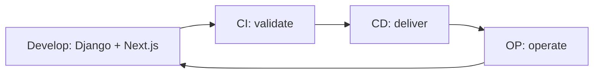

# DevOps

Django-CFG is a Python framework, not an infrastructure requirement. Install it in your application, or start with the complete Docker development workspace published in the [repository](https://github.com/markolofsen/django-cfg).

## CI/CD/OP

CI and CD are established engineering practices. **OP** is our shorthand for the operations layer after delivery. It is a workflow concept, not an additional protocol or deployment engine.

| Layer | Responsibility |
| --- | --- |
| Development | One Git checkout, explicit dependencies, isolated Docker services |
| CI | Tests, type checks, builds, security checks and review |
| CD | Versioned artifacts, approved deployment and health verification |
| OP | Logs, health, machine access, maintenance and recovery |

CMDOP is an optional connection to an enrolled machine. It is not a CI scheduler, automatic reviewer or production deployment system.

## Choose your path

<Cards>
  <Cards.Card title="Quick Start" href="/devops/quick-start">Boot the complete development workspace.</Cards.Card>
  <Cards.Card title="Docker Runtime" href="/devops/docker-runtime">Understand services, ports and persistence.</Cards.Card>
  <Cards.Card title="Remote Development" href="/devops/remote-development">Keep heavy work on an owned Linux server.</Cards.Card>
  <Cards.Card title="AI Agent Workflow" href="/devops/agent-workflow">Coordinate independent changes and review.</Cards.Card>
  <Cards.Card title="CI/CD" href="/devops/ci-cd">Validate and deliver reviewed revisions.</Cards.Card>
  <Cards.Card title="Operations" href="/devops/operations">Inspect and maintain a running system.</Cards.Card>
  <Cards.Card title="Production" href="/devops/production">Design the separate production boundary.</Cards.Card>
  <Cards.Card title="Security & Recovery" href="/devops/security-recovery">Protect access, data and state.</Cards.Card>
  <Cards.Card title="Troubleshooting" href="/devops/troubleshooting">Diagnose startup and dependency failures.</Cards.Card>
</Cards>

Only need the Python library? Follow [Installation](/getting-started/installation).
